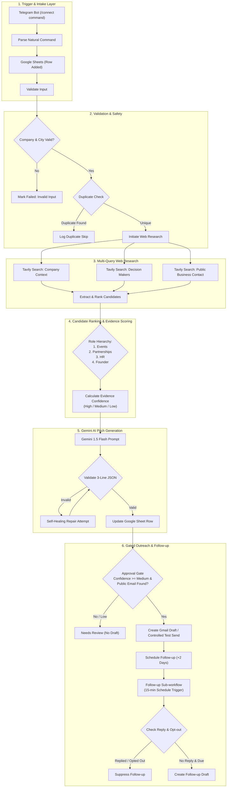

# GoPratle BDR Agent - Architecture Specification

## 1. System Overview

The GoPratle BDR Lead Enrichment & Outreach Agent is a lightweight, event-driven B2B automation system designed to find relevant business contacts, research company context, generate personalized outreach pitches using Google Gemini, create approval-gated Gmail drafts, and automate follow-ups.

---

## 2. Component Responsibilities

| Component | Technology | Responsibility |
| :--- | :--- | :--- |
| **Workflow Orchestration** | n8n / Node.js Runner | Triggers, data flow, branching, retries, idempotency, and status updates. |
| **Lead Database** | Google Sheets | 22-column relational lead store, review flags, message tracking IDs, and timestamps. |
| **Web Research** | Tavily Search API | Multi-query targeted searches for company context, decision-makers, and public business emails. |
| **AI Reasoning & Pitch** | Google Gemini 1.5 Flash | Candidate relevance evaluation, JSON output structuring, and 3-line personalized pitch writing. |
| **Outreach Delivery** | Gmail API | Draft generation by default; controlled test sending to candidate inbox in demo mode. |
| **Follow-up Engine** | n8n Scheduled Workflow | Periodic due-date scanning, reply/opt-out suppression check, and follow-up draft creation. |
| **Optional Command Intake** | Telegram Bot API | Natural-language command parser to add new prospect rows directly from mobile. |

---

## 3. Data Integrity & Anti-Hallucination Controls

1. **Strict Role Hierarchy**:
   - `Events Manager / Head of Events / Event Operations` (Priority 1)
   - `Partnerships Manager / Brand Partnerships` (Priority 2)
   - `HR Head / People Operations` (Priority 3)
   - `Founder / Co-founder / CEO` (Priority 4)
2. **No Data Fabrication**:
   - If a person or email is not present in verifiable search results, the field is explicitly marked `Not Found`.
   - Never guess email patterns (e.g., `first.last@company.com`).
3. **Evidence-Based Confidence**:
   - **High**: Target role, company, city, and verified public email/profile present.
   - **Medium**: Relevant decision-maker identified, but public email or city is unconfirmed. Draft created only for human review.
   - **Low**: Ambiguous title, stale result, or no evidence. Outreach strictly prohibited.

---

## 4. Error Handling & Recovery

- **Invalid Input**: Missing Company or City causes immediate short-circuit; marked `Failed` in Sheet without wasting API credits.
- **Duplicate Prevention**: Normalized company and city matching prevents duplicate enrichment and duplicate outreach.
- **AI Self-Healing**: Invalid JSON or pitch line count triggers an automated repair retry; if still invalid, flagged as `Needs Review`.
- **Gmail Failure**: Network or credential issues leave outreach status as `Not Ready` or `Failed`; never incorrectly marked `Sent`.
- **Follow-up Suppression**: Leads that have replied or opted out are automatically marked `Suppressed`.
