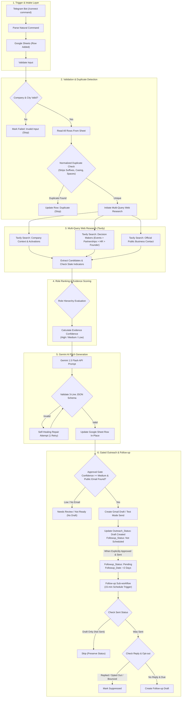

# GoPratle BDR Agent - Production Architecture Specification

## 1. System Overview

The GoPratle BDR Lead Enrichment & Outreach Agent is a lightweight, event-driven B2B automation system designed to find relevant business contacts, research company context, generate personalized outreach pitches using Google Gemini, create approval-gated Gmail drafts, and automate follow-ups.

---

## 2. Implementation & Readiness Status

| Subsystem | Implementation Details | Verification Status | User Action Required |
| :--- | :--- | :--- | :--- |
| **Input Validation** | Whitespace trimming, required field check | **Tested with mocks & live** | None |
| **Duplicate Detection** | Suffix stripping (Ltd, Inc, Pvt), city aliases, cross-sheet matching | **Tested with mocks** | None |
| **Web Research (Tavily)** | 3-query search (Company, Decision-makers, Public Contact) | **Tested with mocks** | Provide `TAVILY_API_KEY` for live runs |
| **Candidate Ranking** | Events (P1) > Partnerships (P2) > HR (P3) > Founder (P4) | **Tested with mocks** | None |
| **Lead Confidence** | Evidence-based scoring (High, Medium, Low) | **Tested with mocks** | None |
| **AI Pitch Engine** | Gemini 1.5 Flash prompt, 3-line schema validation & repair loop | **Tested with mocks** | Provide `GEMINI_API_KEY` for live runs |
| **Google Sheets Read/Write**| REST API v4 read, batch update, in-place row matching | **Tested with mocks** | Configure `GOOGLE_SHEET_ID` & OAuth |
| **Gmail Draft Outreach** | RFC 2822 base64url MIME draft creation | **Tested with mocks** | Connect Gmail OAuth in n8n or `.env` |
| **Follow-up State Machine** | Gated on actual send; skips draft-only; suppresses on reply/opt-out | **Tested with mocks** | None |
| **Telegram Intake** | NLP command parser to append new rows | **Implemented** | Optional: configure `TELEGRAM_BOT_TOKEN` |

---

## 3. Data Integrity & Anti-Hallucination Guarantees

1. **Role Hierarchy**:
   - `Head of Events / Events Manager / Event Operations` (Priority 1)
   - `Partnerships Manager / Brand Partnerships` (Priority 2)
   - `HR Head / People Operations` (Priority 3)
   - `Founder / Co-founder / CEO` (Priority 4)
2. **Zero Hallucination Policy**:
   - If a person or email is not present in verifiable search results, the field is explicitly marked `Not Found`.
   - Never guess email patterns (e.g., `first.last@company.com`).
3. **No Silent Mock Fallbacks**:
   - Production methods do not silently generate mock responses on API failures.
   - Any API error (HTTP 401, 403, 500, timeout) is caught, logged in `Error_Details`, and leaves the lead safely flagged as `Failed` or `Needs Review`.

---

## 4. Error Handling & Branching Rules

- **Invalid Input**: Missing Company or City causes immediate short-circuit; marked `Failed` in Sheet without wasting API credits.
- **Duplicate Prevention**: Matching existing company + city branches to `Record Duplicate in Sheet` and stops further processing.
- **Draft-Only Follow-up Protection**: If a lead's outreach is only `Draft Created`, the follow-up agent skips it without modifying its status to `Suppressed`.
- **Follow-up Suppression**: Leads that have `Reply_Status = 'Replied'` or `'Opted Out'` are automatically marked `Suppressed`.
